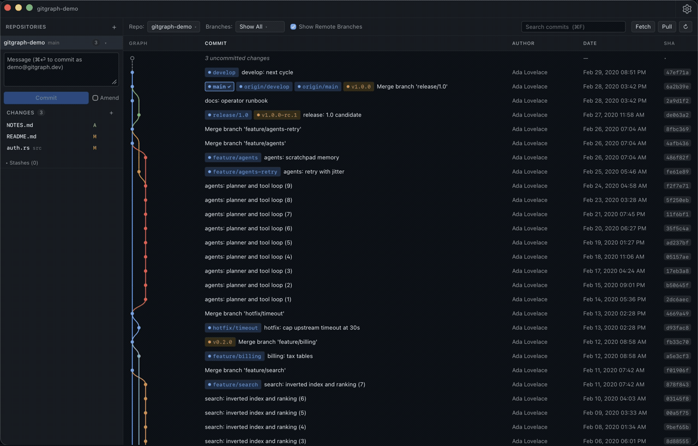

# GitGraph



```bash
pnpm install && pnpm tauri build
```

[Releases](https://github.com/mubashirjamali101/gitgraph/releases/latest)

Opening an editor just to look at a git graph is the wrong tool. GitGraph is a native desktop git client — canvas graph, sidebar staging and commit, inline or side-by-side diffs — built with Tauri 2, Rust, and React. Opening a repository does not mean running its helpers: hijack-vector environment variables are stripped, git cannot prompt, every subprocess is timed out, and refs and paths are validated before they reach an argument list. Your `~/.gitconfig` is trusted; repository hooks are allowed to run.

[SECURITY.md](SECURITY.md) · [MIT](LICENSE)
